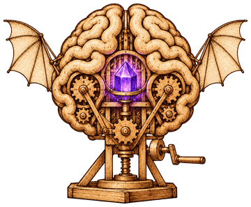

<p align="center">
  
</p>

# mdv-second-brain

**Persistent project memory for coding agents, kept as an Obsidian vault.** A Claude Code and Codex plugin: the agent writes it, you read and correct it in Obsidian.

Claude and Codex forget everything when a session ends. This plugin gives them a second brain per workspace that remembers what was done, why, and what was learned: a Kanban board whose cards link to living task and issue notes, a daily note with the state of every session, distilled project knowledge, ideas, decisions and post mortems. It is written by the agent, without you asking, and workspaces never mix.

It is the agent's second brain for software work, not a personal one: it captures what happens in your coding sessions, not what you read or think elsewhere. The task notes are the visible part. The core is distillation (what lasts moves into feature notes, project hubs, `DECISIONS.md`, `MEMORY.md`), bounded recall (only what the agent needs, never the whole vault) and continuity (the next session, or a parallel one, starts from where you are).

- **Zero manual work.** Claude creates the task when work starts, keeps its status current, distils what lasts into the feature and project notes when a piece is done, and commits the vault.
- **Never forgets.** Hooks track what changed in the session; if Claude edited your project but not the vault, it is reminded once before it stops. If a session dies, the next one starts from the last checkpoint.
- **Strict isolation.** A workspace's vault never mentions another workspace.
- **Inert elsewhere.** Outside a workspace the plugin prints nothing and writes nothing until you activate it.
- **Small context.** The vault is meant to be read by an agent: short injected context, size budgets, rotation of long logs, and bounded reads (`context`, `show --section`, `search`).

## Requirements

- Claude Code with plugin support, or Codex CLI with plugins and hooks (0.163 or later).
- Node.js ≥ 18 (no dependencies). Without Node the plugin stays inactive (silent in Claude Code; Codex reports the failed hook).
- git (optional): without it the vault is still written, just not committed.

## Install

Claude Code:

```
/plugin marketplace add martindavinci/mdv-second-brain
/plugin install mdv-second-brain@mdv-second-brain
```

Codex:

```
codex plugin marketplace add martindavinci/mdv-second-brain
codex plugin add mdv-second-brain@mdv-second-brain
```

Then start `codex` once: at startup it shows **Hooks need review** — choose **Trust all and continue**. Codex never runs plugin hooks you have not trusted, and asks again when an update changes them. `/hooks` lists the four hooks (SessionStart, UserPromptSubmit, PostToolUse, Stop); all four must be trusted and enabled — to re-enable one, select its event, then the second-brain handler, and toggle it on.

Codex runs the agent's commands in a sandbox, and a plugin cannot widen it: the vault root and the plugin's configuration folder must be writable, otherwise every vault write asks for approval. Add them in `~/.codex/config.toml` (`~` is expanded; `%USERPROFILE%` is not):

```toml
[sandbox_workspace_write]
writable_roots = ["~/Documents/SecondBrain", "~/.config/mdv-second-brain"]
```

or start Codex with `codex --add-dir ~/Documents/SecondBrain --add-dir ~/.config/mdv-second-brain`, or use project mode (`brain init --here`), which keeps everything inside the folder. When activation fails because the sandbox cannot write the configuration (exit 8), the agent lists these ways out; on request, `brain init --config-here` keeps the configuration in the activated folder (`<folder>/.config/mdv-second-brain/`, a copy of the global settings plus the new workspace, excluded from the folder's git repo), found from any subfolder.

On Windows the sandbox runs commands as a separate account, so a vault repo created by Codex belongs to that account, and git refuses it from your own account as "dubious ownership" (and the other way round). The plugin's own git commands trust the configured vault's repo for that command only (`git -c safe.directory=<vault>`); your global git config is never changed. For your own git commands in such a vault, take ownership of it: `takeown /f <vault> /r`.

Both hosts share the same configuration and vaults: a workspace activated in one is active in the other.

## Activate

In the folder you work in, say **"attiva brain per questa chat"** / **"enable the second brain here"**, or run `/brain init` (Claude Code) / `$second-brain init` (Codex). The agent asks one round of questions:

1. what to activate — this folder, the parent folder with all its projects, only this project (project mode, below), or only this chat;
2. which workspace — a new one or an existing one;
3. where the vault lives — the common root, inside the folder, or a custom path;
4. git — its own repo with the identity found in the folder, the global identity, no git, or inside the repo that already contains the vault.

`/brain init --quick` (`$second-brain init --quick` in Codex) uses the defaults without questions. "disattiva brain per questa chat" (`brain detach`) turns it off for the current chat.

A folder full of repos? `/brain bootstrap` gives each git repo directly under the workspace's folders a project hub. The CLI does the facts: a generated `## Repo` section (remotes without credentials, branch, commits, last commit, tag, working tree, manifests), refreshed on every run, and the vault, ignored folders and other workspaces left out. The agent writes the prose, with subagents when there are many repos. Relations come as candidates with their evidence (`x-src` next to `x`, a remote pointing to a sibling folder, `../sibling` in scripts, a shared first commit) and are written only once confirmed; references to sibling folders that no longer exist are reported. Run it again after adding or renaming repos: a renamed folder is recognised by its first commit or remote and proposed as a project rename, applied only after you confirm. `brain status` says when there are repos without a hub.

## Storage layouts

- **One root for everything** (default): `<root>/<workspace>/` for every workspace, with `root` = `~/Documents/SecondBrain` (or `~/SecondBrain`).
- **Custom vault per workspace**: any workspace can keep its vault elsewhere, for example inside the folder it maps (`<folder>/SecondBrain`). A vault inside another git repo gets its own repo and is added to the parent's `.git/info/exclude`, or uses the parent repo (`host` mode).
- **Project mode** (`brain init --here`): no workspaces and nothing outside the folder. Vault, configuration and session state all live in `<folder>/SecondBrain` (configuration in `SecondBrain/.brain/local/`, never committed); the vault gets its own git repo, excluded from the project's. The hooks find it from any subfolder; moving the folder keeps it working; subfolders are not split into projects. Inside a wider workspace the project's own brain wins; a workspace mapped inside the project wins in its folder. Useful with Codex, whose sandbox only lets the agent write inside the folder.

## Configuration

`~/.config/mdv-second-brain/config.json` (override with `MDV_SECOND_BRAIN_CONFIG`). It stays on your machine and is never part of a vault.

```json
{
  "root": "~/Documents/SecondBrain",
  "git": { "mode": "per-workspace" },
  "defaults": { "language": "auto" },
  "stopThresholdMinutes": 0,
  "budgets": { "hub": 4000, "note": 8000, "state": 600, "log": 6000, "memory": 8000, "decisions": 8000, "checkpoint": 600 },
  "archiveAfterDays": 14,
  "dailyInboxDays": 7,
  "capturePatterns": ["docs/superpowers/specs/", "docs/superpowers/plans/"],
  "workspaces": {
    "<name>": {
      "paths": ["<folder mapped to this workspace>"],
      "vault": "<optional custom vault path>",
      "language": "<language code>",
      "board": "00_Inbox/Plan.md",
      "git": {
        "mode": "per-workspace",
        "identity": { "name": "<commit name>", "email": "<commit email>" },
        "config": { "include.path": "<relative path to a .gitconfig>" }
      }
    }
  },
  "ignore": ["<folders the plugin must never touch>"]
}
```

- `git.mode`: `per-workspace` (one repo per vault), `single` (the root is one repo), `none`, `host` (commit into the repo that contains the vault).
- `git.identity`: the commit identity of that workspace, found at activation — the folder's repo, a `.gitconfig` in the folder or above it, the repos inside it, or the author of the latest commit there; the global identity is never stored. It is passed to each commit (`git -c`), so shared repos never collect identities; in `host` mode a repo with its own identity keeps it.
- `git.config`: local git settings written into the vault's own repo (`per-workspace` only), so commits you make there by hand match. Global git config is never changed.
- `language: auto`: the vault language is fixed from your chat language at activation.
- Only the values that differ from the defaults are saved, so new defaults reach you on update.

## Vault

```
Home.md  AGENTS.md  WORKFLOW.md  TOOLS.md  DECISIONS.md  MEMORY.md
00_Inbox/
  Plan.md  Bugs.md  Features.md  Ideas.md      board, generated indexes, undecided ideas
  Daily/YYYY-MM-DD.md                          one section per session
  <project>/                                   only for a project you split off
10_Notes/
  Features/  Tasks/  Issues/                   work without a project
  <note>.md                                    knowledge that spans projects
20_Projects/
  <project>.md                                 hub: what the project is now
  <project>/                                   created once there is something to put in it
    <project> — <Topic>.md                     distilled knowledge
    <project> — Post Mortem YYYY-MM-DD.md
    Features/  Tasks/  Issues/
80_Assets/
90_Archive/                                    mirrors the original paths
secrets.local.md  *.local.md  .brain/          never committed
```

The board has four lanes — ToDo, In Progress, Completed, Discarded — and the board wins: drag a card in Obsidian and the note's status follows. Notes are never deleted; deleting moves them to `90_Archive/`. `AGENTS.md`, `WORKFLOW.md` and `TOOLS.md` are generated once and then belong to you: Claude reads them and follows them.

## Commands

`/brain <command>` in Claude Code, `$second-brain <command>` in Codex, or plain language. The CLI is `node scripts/brain.js`.

| Command | What it does |
|---|---|
| `brain init [<ws>] [--quick] [--here] [--config-here] [--path] [--vault] [--git-mode] [--identity] [--language]` | activate a folder; `--here` = project mode; `--config-here` = configuration kept in the folder; `--plan` prints what the guided questions need |
| `brain attach <ws>` / `brain detach` | turn the brain on or off for the current chat only |
| `brain task add "<Name>" [--project] [--feature] [--status]` | new task note + card (same subcommands for `issue`) |
| `brain task list` · `show` · `move` · `block` · `unblock` · `done` · `discard` · `delete --yes` · `sync` | manage tasks and issues |
| `brain feature add "<Name>"` · `brain project add <p>` · `brain postmortem add "<title>"` | create notes from the templates |
| `brain idea add` · `list` · `promote <id> --to "<Name>"` · `discard <id>` | ideas |
| `brain context` · `brain show "<Name>" [--section <heading>] [--max-chars]` · `brain search "<text>"` | bounded reads |
| `brain project list` · `split <p>` · `merge <p>` | give a project its own board and indexes, or fold it back |
| `brain bootstrap [--dry-run]` | a hub for every git repo under the workspace's folders, `## Repo` refreshed on each run; renames, relation candidates, broken sibling references and decision-shaped commits ("switch to", "replace X with Y", "in favour of"…) reported; a decision is written to `DECISIONS.md` only once you confirm it |
| `brain plugins [<id>…] [--dry-run]` | install and enable Obsidian community plugins in the vault: Dataview, Kanban and Homepage (opens `Home.md`) by default, or the ids given; each from the release its repo's `manifest.json` names, as Obsidian does. Installed plugins and your `community-plugins.json` entries and `data.json` settings are kept |
| `brain health [--fix] [--days <n>]` | check the vault: broken `[[links]]` (with the note they most likely mean), orphan notes, items in progress untouched for over 14 days, task, issue, feature and hub notes without frontmatter, duplicate note names, empty folders; `--fix` repoints only links with exactly one certain match (same name but for case, accents, separators or characters a note name cannot hold, keeping the text they showed) and removes empty folders |
| `brain recap [--week\|--month] [--date YYYY-MM-DD] [--max-chars]` | what happened in a day (default), week (Monday to Sunday) or month: tasks and issues closed in it, archived ones too, and each session's state and log from the dailies |
| `brain project rename <old> <new> [--dry-run]` | move the hub, folder, topic notes, split board and archive; rewrite links, `project:` fields and idea headings |
| `brain project relate <a> --depends-on\|--used-by\|--source-of\|--built-from\|--related <b> [--remove]` | a relation written in both hubs (`used_by` is the other side of `depends_on`, `built_from` of `source_of`) |
| `brain secret set` · `get` · `list` | values in `secrets.local.md`, referenced as `{{secret:KEY}}` |
| `brain workspace add` · `list` · `map` · `ignore` | edit the config |
| `brain checkpoint --status … --next … --open … --log …` | update this session's section of the daily (safe with parallel sessions) |
| `brain index` · `brain commit -m "<msg>"` · `brain status` | archive, rebuild indexes, move old-layout hubs to `20_Projects/<project>.md`, prune old session state, commit the vault; status also counts repos without a hub and names the plugins the vault needs that are missing |
| `brain adopt <path> --as <ws> [--apply] [--language]` | adopt an existing vault in place: dry run first, files moved (never copied or deleted), path links rewritten, a `TASKS.md` checklist turned into cards |

## Privacy

- Nothing personal ships with the plugin: no paths, names or identities. Your configuration lives in `~/.config/mdv-second-brain/`.
- Secrets go only in `secrets.local.md`; other `*.local.md` files hold private prose. Both are gitignored, and every commit is scanned for keys and passwords first.
- The plugin never pushes.
- At session start in Claude Code it reads `~/.claude/settings.json`, the project's `.claude/settings*.json` and the `hooks/hooks.json` of installed plugins, only to notice other vault tooling (Obsidian, vault or second-brain hooks) that also injects a manual; it then tells the model that the vault's own rules govern. It changes nothing there and sends nothing anywhere.

## License

[MIT](LICENSE)
